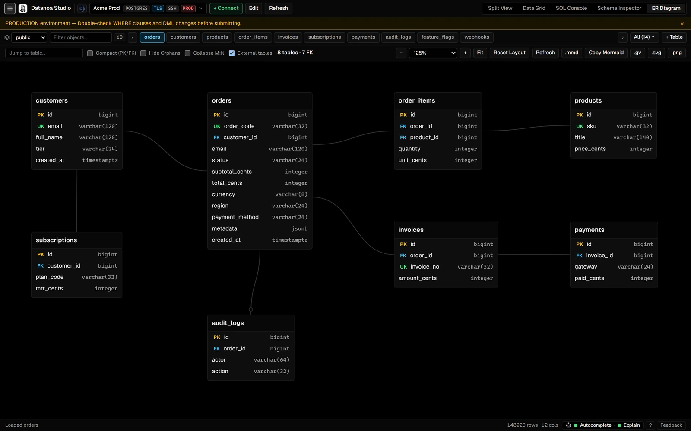
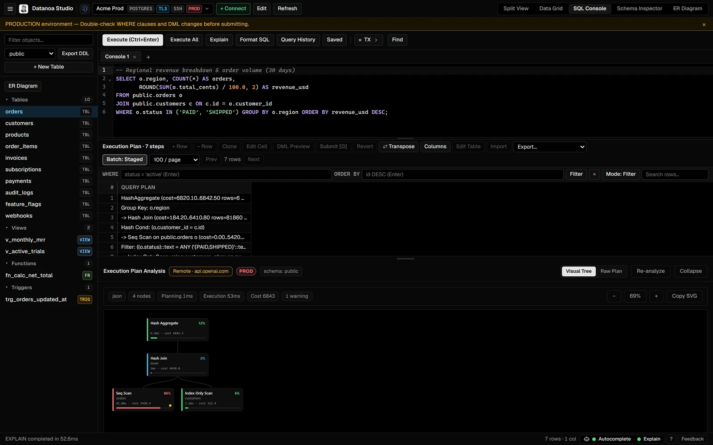
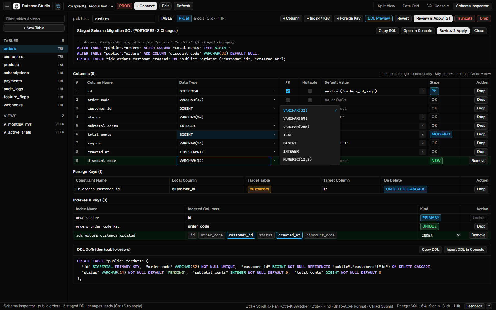
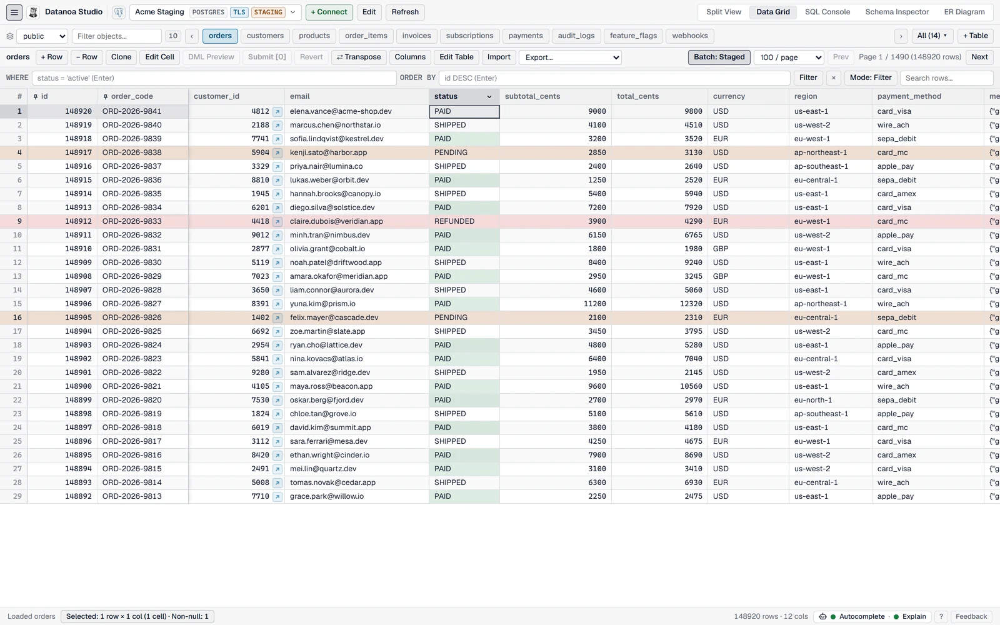
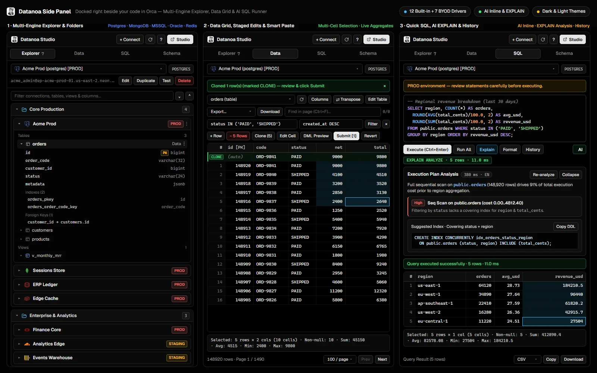

<p align="center">
  
</p>

<h1 align="center">Datanoa Studio — Database Client &amp; SQL Studio for Orca</h1>

<p align="center">
  <strong>Connect, query, visualize, and edit across 12 built-in engines (SQLite, PostgreSQL, MySQL, MariaDB, CockroachDB, ClickHouse, Redis, LibSQL/Turso, Cloudflare D1, MSSQL, Oracle, MongoDB) + 7 BYOD drivers — right inside Orca.</strong>
</p>

<p align="center">
  <a href="https://orca.dev/plugins/thanhh2615.datanoa?catalog=community"></a>
  <a href="https://orca.dev/plugins/thanhh2615/datanoa"></a>
  <a href="https://orca.dev">=1.4.248" /></a>
  <a href="#supported-databases"></a>
  <a href="LICENSE"></a>
  <a href="https://github.com/Thanhh2615/datanoa/issues/new/choose"></a>
</p>

<p align="center">
  
</p>

---

## Highlights (v1.3.0)

- **19 Database Engines (12 Built-In + 7 BYOD):** Zero external binaries for SQLite, PostgreSQL, MySQL, MariaDB, CockroachDB, ClickHouse, Redis, LibSQL/Turso, Cloudflare D1, SQL Server (MSSQL), Oracle, and MongoDB — plus 7 local BYOD driver slots (DuckDB, Snowflake, BigQuery, Cassandra, Elasticsearch, Neo4j, Custom Adapter).
- **Visual Database Architecture & Query Analysis:** Interactive **ER Diagrams** (FK graph, live search, junction collapsing, saved positions, `.mmd`/`.gv`/`.svg`/`.png` export) and offline-first SVG **Visual EXPLAIN Trees** (multi-engine including MSSQL `SHOWPLAN`, bottleneck badges, `Copy SVG`, `Raw Plan`, + **Analyze with AI**).
- **SQL Console (CodeMirror 6):** Up to 20 persisted tabs in **Fullscreen Studio** (`.datanoa`/`.sql`) and **Docked Side Panel**, schema-aware autocomplete, optional **Vim keymap** (`NORMAL`/`INSERT`/`VISUAL`), customizable shortcuts, bind parameters (`?`, `{{name}}`, `${name}`, `:name`, `@name`, `$1`), real-time diagnostics, formatter (`Shift+Alt+F`), manual transactions, and destructive-SQL prompts.
- **Opt-In Dual-Role AI SQL Assistant:** Off by default (`aiEnabled: false`, `aiExplainEnabled: false`). Supports OpenAI-compatible, Anthropic-compatible, Ollama & Mistral Codestral FIM (`7` presets) with shared or split role models/OS-keyring keys, **Inline Ghost Autocomplete** (`Tab`), **Mini-NEP** multi-hunk inline statement edits (`Alt+\`) with worker AST grammar checks, **`Fix with AI`**, **Analyze EXPLAIN with AI** (9 languages + auto), credential redaction, and fail-closed `prod` `aiPolicy`.
- **Virtualized Data Grid & Schema Tools:** Virtual scrolling, **Columns Manager** (filter, show/hide, drag/`Alt+Arrow` reorder, pin up to 2/3 viewport width, **Wrap cells** + max lines, **Conditional Highlighting**), transposed row view, staged inline edits + `DML Preview`, live aggregates, FK jump (`Ctrl+Click`/`↗`), lossless `BIGINT` JSON/Value Inspector, `CSV`/`TSV`/`JSON`/`NDJSON` import (+ streaming PostgreSQL `COPY`), `CSV`/`TSV`/`JSON`/`NDJSON`/`SQL`/`Markdown` export, connection/folder drag-reorder & multi-schema quick pickers, and **Table Designer** with migration SQL preview.
- **Security & Workspace Discovery:** Multi-hop **SSH jump tunnels** (0–4 hops + bastion configured in Studio via bundled `ssh2` + `~/.ssh/known_hosts` trust modal; Side Panel preserves existing hops), fail-closed **TLS/mTLS** (including MSSQL `strict` TDS 8.0) with safe 1-click fixes, and **Workspace Auto-Discovery** (`.env`, Docker Compose across 10 engines, local `.db`/`.sqlite`).

---

## Supported Databases

### Built-In Engines (12)

| Engine | Default Port | Transport & Security | Highlights |
|---|---|---|---|
| **SQLite** | Local / `:memory:` | Local `.db` / `.sqlite` / `.sqlite3` discovery | Transactions, table rebuild migrations (`GENERATED`, `CHECK`, `STRICT`, `WITHOUT ROWID`) |
| **PostgreSQL** | `5432` | Auto-SSL, fail-closed TLS/mTLS, SSH tunnel | Multi-schema browser, query cancel, `EXPLAIN`, savepoint TX, `COPY` streaming import |
| **MySQL** | `3306` | Auto-SSL, fail-closed TLS/mTLS, SSH tunnel | Pooled connections, query cancel, `EXPLAIN`, transactions |
| **MariaDB** | `3306` | Auto-SSL, fail-closed TLS/mTLS, SSH tunnel | Catalog introspection, `EXPLAIN`, transactions, Table Designer |
| **CockroachDB** | `26257` | TLS by default, custom TLS/mTLS, SSH tunnel | Cluster URI support, distributed transactions, `EXPLAIN` |
| **ClickHouse** | `8123` / `8443` | HTTP(S), Auto-HTTPS, TLS/mTLS, SSH tunnel | Streaming queries, verified mutations, chunked inserts, `EXPLAIN` |
| **Redis** | `6379` | TCP / TLS (`rediss://`), TLS/mTLS, SSH tunnel | `SCAN` keyspace browser (`db0`–`db15`), type inspector, command runner |
| **LibSQL / Turso** | `443` | HTTPS / `libsql://` (keyring token) | Batched pipeline writes, SQLite-compatible schema & `EXPLAIN` |
| **Cloudflare D1** | `443` | HTTPS API (`d1://`, keyring token) | Batched REST commits, lossless `BIGINT` parsing, schema & `EXPLAIN` |
| **SQL Server (MSSQL)** | `1433` | TLS/mTLS + TDS 8.0 `strict`, SSH tunnel | Bundled `mssql`/`tedious`, `GO` batches, pooled TX, `SET SHOWPLAN_XML` / `SHOWPLAN_ALL` |
| **Oracle Database** | `1521` | Thin TCP/TCPS, Easy Connect & TNS, SSH tunnel | Bundled `oracledb`, PL/SQL & `/` scripts, `EXPLAIN PLAN` |
| **MongoDB** | `27017` | `mongodb://` & `mongodb+srv://`, TLS/mTLS, SSH | Bundled `mongodb`, MQL console, transactions, BSON grid, `explain()` |

### Local BYOD Engines (7 Driver Slots)

Extend Datanoa with locally installed Node.js adapters — zero automatic network downloads:

| Slot | Default Port | Starter Package |
|---|---|---|
| **DuckDB** (`duckdb`) | Local file | `@duckdb/node-api` |
| **Snowflake** (`snowflake`) | `443` | `snowflake-sdk` |
| **Google BigQuery** (`bigquery`) | `443` | `@google-cloud/bigquery` |
| **Apache Cassandra** (`cassandra`) | `9042` | `cassandra-driver` |
| **Elasticsearch** (`elasticsearch`) | `9200` | `@elastic/elasticsearch` |
| **Neo4j** (`neo4j`) | `7687` | `neo4j-driver` |
| **Custom Adapter** (`custom`) | `5432` | Custom `IDatabaseDriver` module |

> **Setup & Trust:** Open **New Connection** or **Driver Manager** -> **Create Folder & Copy Cmd** (`npm install --ignore-scripts`) -> inspect SHA-256 -> **Trust & Verify**. SHA-256 verifies the entry file bytes; relative imports and `node_modules` inside the folder load via Node once trusted.

---

## Install & Quick Start

- **Orca Directory:** **[Open & Install Datanoa Studio in Orca →](https://orca.dev/plugins/thanhh2615.datanoa?catalog=community)** ([directory page](https://orca.dev/plugins/thanhh2615/datanoa)), or search **`Datanoa Studio`** in **Settings → Plugins → Community Plugins**.
- **Orca CLI:**
  ```bash
  orca plugin install https://github.com/Thanhh2615/datanoa#v1.3.0
  ```
- **Local Dev:** `git clone https://github.com/Thanhh2615/datanoa.git && cd datanoa && npm install && npm run verify && orca plugin dev load .`

1. Open **Fullscreen Studio** (`+` -> **Datanoa Studio**, or any `.sql` / `.datanoa` file) or **Side Panel** (Right Sidebar **Datanoa** icon).
2. Click **`+ Connect`**, paste a URI (`postgres://`, `mysql://`, `mssql://`, `oracle://`, `mongodb://`, `redis://`, `libsql://`, `d1://`, `clickhouse://`, `sqlite://`), or run **`Auto-Detect (.env, Docker, .db)`**.

---

## Screenshots

### Split View — SQL Console, Inline AI Ghost Completion, Transactions & JSON Inspector
<p align="center">
  
</p>

### Interactive ER Diagram — PK/FK/UK Badges, Crow's Foot Edges & Schema Export
<p align="center">
  
</p>

### Visual EXPLAIN Tree & AI Execution Plan Analysis
<p align="center">
  
</p>

### Connection Manager — 12 Built-In + 7 BYOD Engines & Auto-Discovery
<p align="center">
  
</p>

### Visual Table Designer & Migration SQL Preview
<p align="center">
  
</p>

### Light Theme — Quick Table Switcher, Pinned Columns & Conditional Highlighting
<p align="center">
  
</p>

### Docked Side Panel — Multi-Engine Explorer, Staged Grid & Visual EXPLAIN
<p align="center">
  
</p>

---

## Keyboard Shortcuts

| Shortcut / Gesture | Action | Scope |
|---|---|---|
| `Ctrl+Enter` / `Cmd+Enter` | Run SQL statement at caret or selection (`Ctrl+Shift+Enter` runs all) | SQL Console & Side Panel |
| `Tab` | Accept AI ghost completion / statement diff, trigger AI after SQL, or indent | SQL Console & Side Panel |
| `Alt+\` | Trigger AI Statement Edit (Mini-NEP typo/grammar fix & completion) | SQL Console & Side Panel |
| `Ctrl+Right` / `Ctrl+Alt+Right` | Accept next word / next line of AI ghost completion | SQL Console & Side Panel |
| `Ctrl+F` / `Ctrl+H` | Find / Find & Replace in SQL editor (`Shift+Alt+F` formats SQL) | Studio & Side Panel |
| `Ctrl+S` / `Cmd+S` | Submit staged data edits or schema migration | Data Grid & Table Designer |
| `Ctrl+K` (`Ctrl+P` in Studio) / `Ctrl+/` | Command Palette (`Ctrl+P`: Studio quick switcher) / Keyboard Shortcuts | Studio & Side Panel |
| `Enter` / `F2` / `Delete` | Edit cell inline / set selected nullable cells to `NULL` | Data Grid & Side Panel |
| `Ctrl+Click` (or `↗`) | Jump to referenced Foreign Key row (`Escape` closes or dismisses) | Data Grid & Side Panel |

---

## Security, Privacy & Capabilities

Datanoa runs as an Orca `trusted-worker` plugin with strict least-privilege storage and zero telemetry:

| Capability | Purpose |
|---|---|
| `storage:own` | Connection profiles, saved queries, query history, grid display state, ER layout positions, BYOD trust records, session state. |
| `secrets:own` | Passwords, tokens, TLS passphrases, per-hop SSH secrets, and host-pinned AI API keys in Orca's OS keyring. |
| `workspace:read` | Scans `.env`, `docker-compose*.yml`/`compose*.yml`, and local SQLite `.db` files on user request. |
| `workspace:write` | Writes `.datanoa/` sessions, user-requested exports (data, DDL, ER `.mmd`/`.gv`/`.svg`/`.png`), and BYOD driver scaffolds. |
| `settings:own` | Reads `maxRows` (`1–50000`), `queryTimeoutSeconds` (`1–110`), AI settings (`aiEnabled: false`, `aiExplainEnabled: false` by default), and keymaps. |

### Data Flow & Safeguards

- **AI Privacy & Policy:** Both AI roles are **off by default** (`aiEnabled: false`, `aiExplainEnabled: false`). Inline completion and `EXPLAIN`/`Fix with AI` send only bounded SQL/plan context and pruned relevant schema identifiers — never raw table rows. API keys are host-pinned in the OS keyring (`3xx` redirects, cloud metadata IPs, and non-loopback `http://` blocked), secret scanners fail closed on active credentials, `aiPolicy` defaults `prod`/`production` connections to `ask` (`Allow` / `Ask` / `Never`), and local loopback endpoints never auto-route background edits to remote cloud endpoints.
- **Transport & Execution Guards:** Multi-hop SSH jump tunnels run in-process via pure-JS `ssh2` with `~/.ssh/known_hosts` verification and `@revoked` blocking (no `ssh` child processes or `~/.ssh/config` execution). TLS fails closed (`verify-full` / MSSQL `strict` TDS 8.0) with credential-less probing and zero bypass actions on hard cert errors. Read-Only mode enforces query/driver allowlists, destructive queries prompt for confirmation, and diagnostics/history scrub secrets automatically.
- **Local Files & Discovery:** On explicit user-triggered **Auto-Detect**, Docker Compose discovery reads workspace Compose/dotenv files and optionally invokes read-only `docker ps` / `docker inspect` (no shell) when Docker CLI is installed. Non-secret UI state backups (`~/.datanoa/workspace-backup.json`, `0o600`, zero passwords/tokens) and user-created BYOD driver scaffolds (`~/.datanoa/drivers/`) use symlink-safe atomic writes.

---

## Feedback & License

- Use the in-app **`Feedback`** button or file an issue at **[github.com/Thanhh2615/datanoa/issues](https://github.com/Thanhh2615/datanoa/issues/new/choose)**.
- See [CONTRIBUTING.md](CONTRIBUTING.md) and [THIRD-PARTY-NOTICES.md](THIRD-PARTY-NOTICES.md).
- Released under the [MIT License](LICENSE). Copyright © 2026 Thanhh2615.
