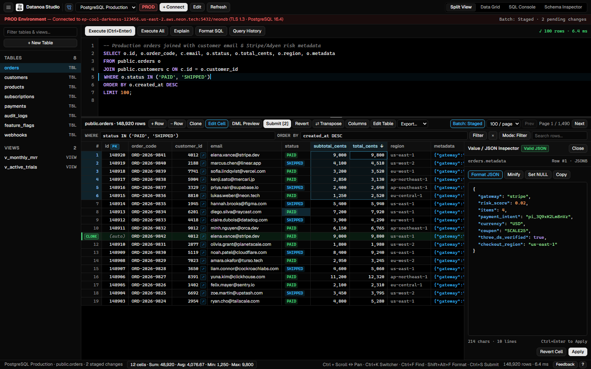
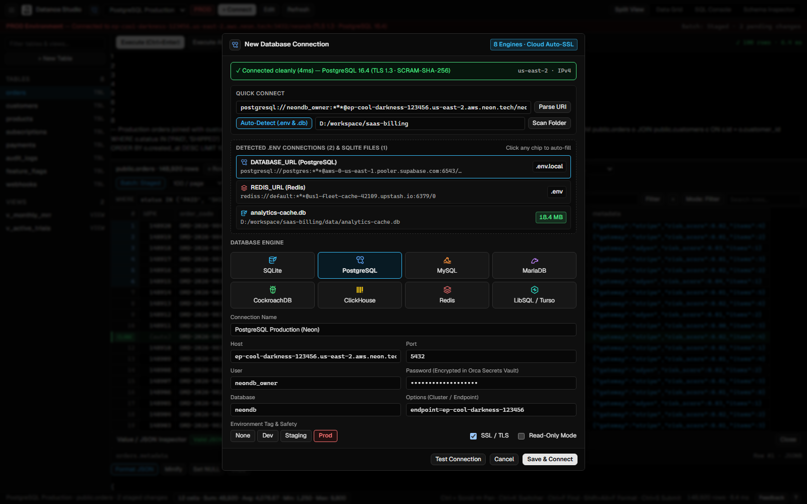
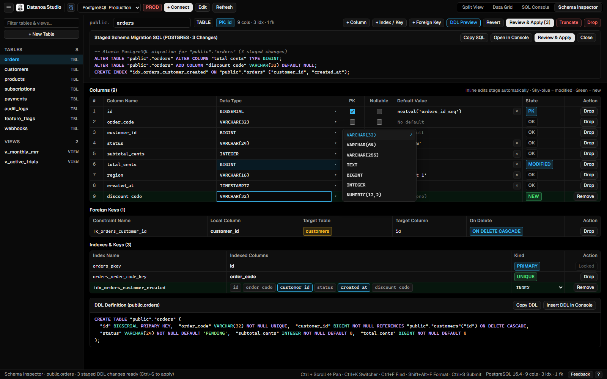
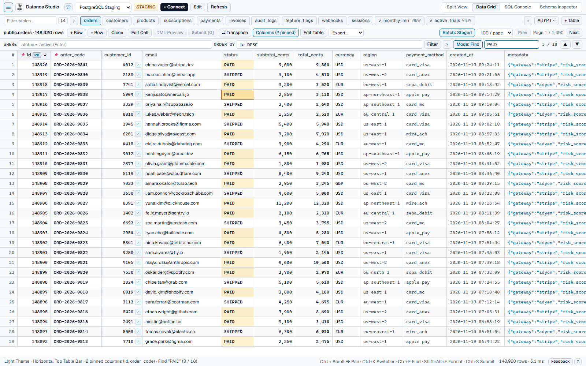
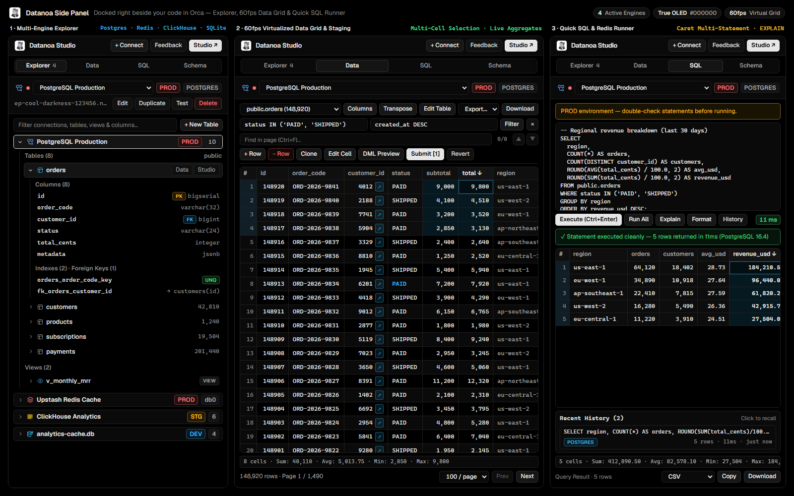

<p align="center">
  
</p>

<h1 align="center">Datanoa Studio — Database Client &amp; SQL Studio for Orca</h1>

<p align="center">
  <strong>Browse tables, edit data inline, design schemas visually, and run SQL or Redis queries across 8 database engines — right inside Orca.</strong>
</p>

<p align="center">
  <a href="https://onorca.dev">=1.4.248" /></a>
  <a href="#8-supported-database-engines"></a>
  <a href="#data-grid-bulk-operations--sql-console"></a>
  <a href="LICENSE"></a>
  <a href="https://github.com/Thanhh2615/datanoa/issues/new/choose"></a>
</p>

<p align="center">
  
</p>

---

## Why Datanoa?

Switch less between your code editor and heavy external database tools. **Datanoa** brings a complete database client, schema designer, and SQL/Redis workspace directly into **Orca** (`>=1.4.248`):

- **Side Panel & Fullscreen Studio:** Inspect tables right beside your code in Orca's **Right Sidebar Panel**, or open a fullscreen **Datanoa Studio** tab (`.datanoa` / `.sql`) straight from Orca's `+` Tab Bar menu.
- **8 Database Engines Built In:** Connect to **SQLite**, **PostgreSQL**, **MySQL**, **MariaDB**, **CockroachDB**, **ClickHouse**, **Redis**, and **LibSQL / Turso** with zero native compilation or external CLI dependencies.
- **Auto-Discovery & One-Click URI Setup:** Paste a connection URI (`Neon`, `Supabase`, `Turso`, `Upstash`, `ClickHouse Cloud`, `CockroachDB Cloud`, `RDS`) or auto-detect `.env` connection strings and local `.db` / `.sqlite` files in your workspace.
- **Fast Virtualized Data Grid:** Smoothly browse, filter, sort, pin columns, and drag-select ranges across large tables with instant status-bar math aggregates (`Count`, `Sum`, `Avg`, `Min`, `Max`).
- **Safe Transactional Editing & Schema Design:** Stage inline cell edits, cloned/pasted rows, and visual `ALTER TABLE` schema migrations locally, review the exact generated SQL, and commit atomically inside transactions with optimistic concurrency checks.
- **Native Orca Look & Feel:** Automatically adapts to Orca's Dark and Light themes (`--orca-*` design tokens and `Geist` typography).

---

## 8 Supported Database Engines

| Engine | Driver ID | Default Port | Wire Protocol & Transport | Cloud Auto-SSL & Resilience | Transaction & Mutation Safety |
|---|---|---|---|---|---|
| **SQLite** | `sqlite` | Local file / `:memory:` | Built-in `node:sqlite` (`DatabaseSync`) isolated in Node `worker_threads` | Instant workspace `.db` / `.sqlite` / `.sqlite3` BFS scanner (`800ms` budget) | `BEGIN IMMEDIATE` batch transactions + **12-step atomic table rebuild** for full `ALTER TABLE` parity |
| **PostgreSQL** | `postgres` | `5432` | Pre-bundled `pg` + `pg-cursor` (`vendor/pg.js`) with `DATE` string preservation & `rowMode: 'array'` | Auto-SSL on 22+ cloud providers, `options` (`endpoint=...`) preservation & **Supabase IPv6-to-IPv4 Supavisor bridge** | `BEGIN` / `COMMIT` / `ROLLBACK` transactions, backend `pg_cancel_backend(pid)` query cancellation & optimistic concurrency |
| **MySQL** | `mysql` | `3306` | Pre-bundled pure-JS `mysql2` (`vendor/mysql2.js`) with connection pooling | Cloud Auto-SSL (`sslmode=require`, PlanetScale, Aiven, AWS RDS, Railway, TiDB Cloud) | Pooled transactional batch staging, `KILL QUERY` cancellation & MySQL `/*!...*/` executable comment awareness |
| **MariaDB** | `mariadb` | `3306` | Pre-bundled pure-JS `mysql2` (`vendor/mysql2.js`) with MariaDB metadata introspection | Cloud Auto-SSL & URI flag resolution (`tls`, `ssl`, `sslmode`) | Atomic batch DML transactions & backtick-escaped DDL migration planner |
| **CockroachDB** | `cockroachdb` | `26257` | PostgreSQL wire protocol (`vendor/pg.js`) with CockroachDB DDL/cluster awareness | TLS enabled by default + full `?options=--cluster=...` round-trip preservation | Distributed SQL transactional batch commit & dialect-aware `EXPLAIN` |
| **ClickHouse** | `clickhouse` | `8123` / `8443` | Native HTTP(S) `JSONCompact` streaming & parameterized mutation driver | Auto-HTTPS on port `8443` and `.clickhouse.cloud` endpoints with basic/header auth | Dialect-aware `ALTER TABLE ... UPDATE` / `DELETE` & `INSERT INTO` batch execution |
| **Redis** | `redis` | `6379` | Zero-dependency native TCP / TLS RESP2 protocol client (`db0`–`db15`) | Auto-TLS on `rediss://` and `.upstash.io` endpoints (respecting explicit `ssl` toggle) | Non-blocking `SCAN` keyspace pagination, type inspection (`string`, `hash`, `list`, `set`, `zset`) & command runner |
| **LibSQL / Turso** | `libsql` | `443` | Hrana v2 HTTP pipeline client (`/v2/pipeline`) | HTTPS / `libsql://` transport with encrypted `authToken` storage in Orca's `secrets:own` vault | Batched pipeline transactions + atomic 12-step SQLite-compatible schema migration rebuild |

---

## Install in Orca

### 1. From Orca Community Plugins (Recommended)

Open **Orca** → **Settings** → **Plugins** → **Community Plugins** (`https://github.com/stablyai/orca-community-plugins.git`), search for **Datanoa** (`thanhh2615.datanoa`), and click **Install**.

### 2. Via Orca CLI

```bash
orca plugin install https://github.com/Thanhh2615/datanoa.git
```

### 3. Local Development

```bash
git clone https://github.com/Thanhh2615/datanoa.git
cd datanoa
npm install
npm run verify
orca plugin dev load .
```

---

## How to Open & Use Datanoa

Datanoa integrates into Orca across four natural entry points:

1. **Open Fullscreen Studio from Orca's `+` Tab Bar:** Click **`+`** on Orca's editor tab bar and select **Datanoa Studio** to open a standalone `.datanoa` studio tab.
2. **Open the Docked Side Panel:** Click the **Datanoa** database icon in Orca's Right Sidebar Panel to browse schemas, inspect rows, or run quick queries right beside your code.
3. **Open Any `.sql` or `.datanoa` File:** Opening any `.sql` or `.datanoa` file in your workspace launches the full Datanoa Studio custom editor automatically.
4. **Connect in One Click (`+ Connect`):** Click **`+ Connect`** in either Fullscreen Studio or the Side Panel to paste a connection URI (`postgres://`, `mysql://`, `redis://`, `libsql://`, `clickhouse://`, `sqlite://`), pick any of the 8 database engines, or click **`Auto-Detect (.env & .db)`** to import credentials from `.env` / `.env.local` / `.env.development` and local SQLite `.db` files.

---

## Visual Walkthrough & Screenshots

### 1. Split View — SQL Console, Interactive Data Grid & Value/JSON Inspector

Write multi-statement SQL with dialect-aware syntax highlighting and smart column/alias autocomplete in the top pane while browsing and staging edits on large tables below — complete with live multi-cell selection math (`Count`, `Sum`, `Avg`, `Min`, `Max`), `CLONE` row badges, Foreign Key jump badges (`↗`), and a dockable **Value / JSON Inspector**.

<p align="center">
  
</p>

### 2. 8-Engine Connection Manager, URI Quick-Fill & Workspace Auto-Detect

Paste any cloud or local database URI (`Neon`, `Supabase`, `Turso`, `Upstash`, `ClickHouse Cloud`, `CockroachDB Cloud`, `RDS`), auto-detect `.env` variables (`DATABASE_URL`, `REDIS_URL`, `TURSO_DATABASE_URL`) and workspace SQLite files, tag environments (`None`, `Dev`, `Staging`, `Prod`), and verify connectivity with live latency diagnostics.

<p align="center">
  
</p>

### 3. Visual Table Structure Designer & Live Migration SQL Preview

Edit table schemas visually in **Schema Inspector** mode: add, rename, or re-type columns with the in-DOM dialect Data Type Combobox, configure Primary Keys, Nullability, and smart Default Values, manage composite Indexes and Foreign Keys (`ON DELETE CASCADE` / `SET NULL` / `RESTRICT`), inspect live `ALTER TABLE` / `CREATE INDEX` DDL in the **Staged Schema Migration SQL** drawer, and apply atomically (`Ctrl+S`). On SQLite and LibSQL, complex structural edits automatically execute a 12-step atomic table rebuild preserving data, indexes, and foreign keys.

<p align="center">
  
</p>

### 4. Clean Light Theme (`html.light`), Horizontal Top Table Switcher & Pinned Columns

Switch Orca to a light theme and Datanoa adapts automatically. Collapse the left sidebar into the **Horizontal Top Table Switcher Bar** to maximize horizontal grid space, pin key identifier columns (`id`, `order_code`) to the left edge with opaque elevation shadows, and use **Find & Highlight (`Ctrl+F`)** to jump across matching cells in real time.

<p align="center">
  
</p>

### 5. Docked Side Panel — Schema Explorer, Data Grid & Quick SQL Runner

Use the **Datanoa Side Panel** without leaving your active code editor: expand multiple database connections simultaneously in the **Explorer** tree, stage and filter data in the virtualized **Data** tab with live multi-cell selection math, or run multi-statement queries in the **SQL** tab with persistent history and 1-click exports.

<p align="center">
  
</p>

---

## Data Grid, Bulk Operations & SQL Console

- **Rectangular Multi-Cell Selection & Live Math Aggregates:** Drag across cells, Shift-click ranges, click row numbers or column headers, or press `Ctrl+A`. The status bar immediately computes **`Count`**, **`Sum`**, **`Avg`**, **`Min`**, and **`Max`** across numeric cells (click the aggregate pill to copy statistics to the clipboard).
- **Multi-Format Copy, Paste & Export:**
  - Copy any cell range as **TSV** (`Ctrl+C`), **CSV**, **JSON**, **NDJSON**, **SQL `IN (...)` list**, **SQL `INSERT`**, **SQL `UPDATE`**, or **Markdown table** from the right-click context menu or Export selector.
  - **Paste as New Row(s) (`Ctrl+V`):** Paste multi-row TSV or CSV data from Excel, Google Sheets, or another table directly into existing cells or as newly staged rows.
  - **Bulk Fill Selected Cells:** Fill an entire rectangular selection with a constant value or `NULL` in one operation.
- **Transactional Row Staging & `CLONE` Badges:** Stage inline cell edits (sky-blue highlight), new rows (`+ Row`), row deletions (`− Row`), and cloned rows (`Clone` → marked with a `CLONE` badge while automatically omitting unedited `AUTOINCREMENT` and `DEFAULT` columns so the database engine evaluates true defaults cleanly). Preview exact SQL via **`DML Preview`** before clicking **`Submit [N]`** (`Ctrl+S`).
- **Pin / Freeze Columns & Column Visibility:** Pin arbitrary columns to the left edge of the grid and toggle column visibility per table (persisted across sessions).
- **Quick Filter & Server `WHERE` / `ORDER BY` Bar:** Right-click any cell to **`Filter by Value (=)`** or **`Exclude Value (!=)`**, or type custom `WHERE` and `ORDER BY` clauses protected by `sanitizeFilterClause` against statement breakout.
- **1-Click Foreign Key Jump (`Ctrl+Click` / `↗`):** Click the `↗` badge or `Ctrl+Click` any foreign key cell to open the referenced parent table filtered directly to that primary key.
- **Dockable Value & JSON Inspector:** Inspect and edit large text or JSON payloads, validate JSON syntax live, one-click **`Format JSON`** / **`Minify JSON`**, set `NULL`, or copy values.
- **Dialect-Aware SQL Console & Smart Autocomplete:** Powered by CodeMirror 6 with syntax highlighting, dialect-aware SQL formatting (`Shift+Alt+F`), caret-aware statement splitting (`Ctrl+Enter` runs the statement at the cursor; `Ctrl+Shift+Enter` runs all statements), table/alias-aware column autocomplete, Redis command completion, `EXPLAIN` execution plans, and persistent Query History.

---

## Keyboard Shortcuts

| Shortcut / Gesture | Action | Scope |
|---|---|---|
| `Ctrl+Enter` / `Cmd+Enter` | Execute SQL statement at current caret position (or active selection) | SQL Console & Side Panel |
| `Ctrl+Shift+Enter` | Execute all statements in the SQL console sequentially | SQL Console |
| `Shift+Alt+F` | Format SQL buffer with dialect-aware indentation & keyword casing | SQL Console & Side Panel |
| `Ctrl+S` / `Cmd+S` | Submit staged data edits (`INSERT` / `UPDATE` / `DELETE`) or staged schema migration | Data Grid & Schema Designer |
| `Ctrl+F` / `Cmd+F` | Focus Find & Highlight bar (`Enter` / `Shift+Enter` to cycle matches) | Data Grid & Side Panel |
| `Ctrl+K` / `Ctrl+P` | Open Quick Switcher / Command Palette (tables, connections, views, actions) | Fullscreen Studio |
| `Ctrl+/` | Open Keyboard Shortcuts cheatsheet modal | Fullscreen Studio |
| `Arrow Keys` / `Shift+Arrow` | Navigate cells and extend rectangular multi-cell selection | Data Grid & Side Panel |
| `Ctrl+A` / `Cmd+A` | Select all visible cells in the current table or query result | Data Grid & Side Panel |
| `Ctrl+C` / `Ctrl+V` | Copy selected range as TSV / Paste TSV or CSV data into grid | Data Grid & Side Panel |
| `Enter` / `F2` / `Double-Click` | Open inline cell editor (`Tab` / `Shift+Tab` to commit and move horizontally) | Data Grid & Side Panel |
| `Delete` / `Backspace` | Stage `NULL` across selected nullable cells (blocks `NOT NULL` columns safely) | Data Grid & Side Panel |
| `Ctrl+Click` (or click `↗`) | Jump directly to referenced Foreign Key row in parent table | Data Grid & Side Panel |
| `Ctrl + Mouse Wheel` | Smooth horizontal panning across wide data grids, SQL results & DDL cards | Fullscreen Studio & Side Panel |
| `Drag / Double-Click Column Edge` | Resize column width smoothly or auto-fit column width (`64px–480px`) to content | Fullscreen Studio & Side Panel |
| `Escape` | Cancel inline edit or close active context menu, popover, drawer, or modal | Fullscreen Studio & Side Panel |

---

## Security, Privacy & Capabilities

Datanoa runs under Orca's `"trusted-worker"` execution model (`manifestVersion: 2`, `pluginApi: 1`) with minimal, scoped permissions:

| Capability | Purpose in Datanoa |
|---|---|
| `storage:own` | Stores non-sensitive connection profiles (`datanoa.savedConnections`), query history, and UI view state (`datanoa.studioViewState`, `datanoa.panelViewState`). |
| `secrets:own` | Stores database passwords (`pwd_<id>`) and Turso/LibSQL bearer tokens (`tok_<id>`) exclusively inside Orca's OS-backed encrypted secrets vault. Secrets are never written to plain storage or `.datanoa` files. |
| `workspace:read` | Enables bounded `.env` / `.env.local` connection discovery and asynchronous BFS discovery of workspace `.db` / `.sqlite` / `.sqlite3` files (blocking system/home root crawls). |
| `workspace:write` | Creates `.datanoa/` studio session files and exports user-requested CSV / JSON / SQL / Markdown dumps. |
| `settings:own` | Reads user-configured `maxRows` (`1–50,000`, default `1,000`) and `queryTimeoutSeconds` (`1–110`, default `30`). |

- **Strict Read-Only & `PROD` Guards:** Connections marked **Read-Only** enforce worker-level mutation blocking (`isMutatingStatement`) across every single-statement and multi-statement query (`INSERT`, `UPDATE`, `DELETE`, `ALTER`, `DROP`, `TRUNCATE`, `CREATE`, `REPLACE`, and Redis write commands), powered by a dialect-aware SQL lexer (`src/drivers/common/sql-lexer.ts`) that properly scans dollar-quoted strings (`$tag$...$tag$`), PostgreSQL `E'...'` escapes, MySQL/MariaDB/ClickHouse `\'` & `#` comments, and MySQL `/*!...*/` executable comments.
- **CSP & Bundle Compliance:** All pre-bundled vendor modules (`vendor/pg.js`, `vendor/mysql2.js`, `vendor/codemirror.js`) are audited at build time (`build/bundle-drivers.mjs`) to ensure each file is strictly `< 1 MiB` with zero `eval(` and zero `new Function(`.
- **Zero Telemetry:** Datanoa makes zero background network calls and collects zero telemetry. Network connections occur exclusively to user-configured database endpoints.

---

## Feedback, Bug Reports & Feature Requests

Have a bug to report or a feature / UI improvement to suggest?

1. **In-App Feedback Modal (1-Click):**
   - In **Fullscreen Studio**, click **`Feedback`** in the bottom-right status bar (next to `?`), run **`Report Bug / Request Feature...`** from the Command Palette (`Ctrl+K`), or click **`Report Issue`** directly on any query error banner.
   - In the **Datanoa Side Panel**, click **`Feedback`** in the top header bar.
   - Choose **Bug Report** or **Feature Request**, enter a summary, and review the auto-filled **Privacy-Safe Diagnostic Summary** (contains only Datanoa version, surface, active engine type, view mode, read-only status, and sanitized error text with URI credentials masked — **never** hostnames, usernames, passwords, tokens, or file paths).
   - Click **`Open on GitHub Issues ↗`** to launch a pre-filled issue on GitHub (while also copying the Markdown report to your clipboard automatically), or click **`Copy Report`**.
2. **Direct on GitHub:**
   - Open a guided Bug Report or Feature Request anytime at **[github.com/Thanhh2615/datanoa/issues](https://github.com/Thanhh2615/datanoa/issues/new/choose)**.

See [CONTRIBUTING.md](CONTRIBUTING.md) for local build, test (`385+` tests), and pull request guidelines, and [THIRD-PARTY-NOTICES.md](THIRD-PARTY-NOTICES.md) for bundled open-source license attributions.

---

## License

Released under the [MIT License](LICENSE). Copyright © 2026 Thanhh2615.
