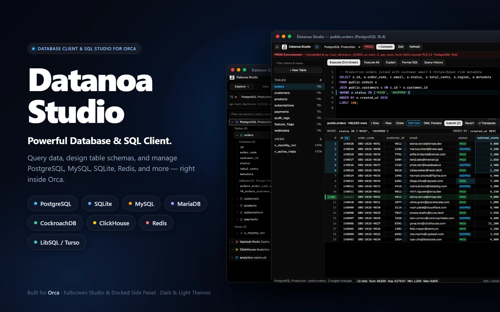
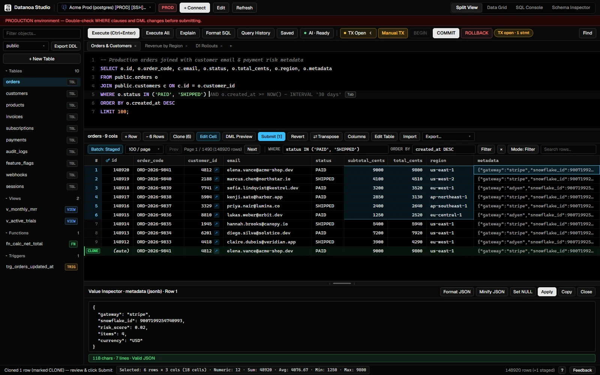
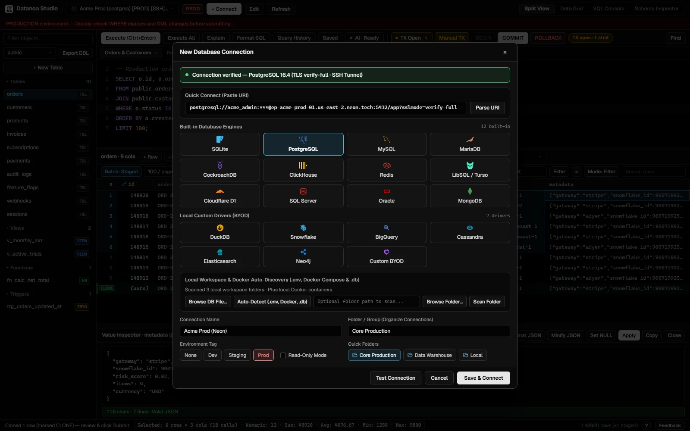

<p align="center">
  
</p>

<h1 align="center">Datanoa Studio — Database Client &amp; SQL Studio for Orca</h1>

<p align="center">
  <strong>Browse multi-schema objects, edit data inline, paste spreadsheets, import CSV/JSON, design schemas visually, and run multi-tab SQL or Redis queries over SSH &amp; TLS across 9 built-in engines + BYOD local drivers — right inside Orca.</strong>
</p>

<p align="center">
  <a href="https://orca.dev/plugins/thanhh2615.datanoa?catalog=community"></a>
  <a href="https://orca.dev/plugins/thanhh2615/datanoa"></a>
  <a href="https://orca.dev">=1.4.248" /></a>
  <a href="#9-supported-database-engines"></a>
  <a href="#data-grid-smart-paste-import--sql-console"></a>
  <a href="LICENSE"></a>
  <a href="https://github.com/Thanhh2615/datanoa/issues/new/choose"></a>
</p>

<p align="center">
  
</p>

---

## Why Datanoa?

Switch less between your code editor and external database tools. **Datanoa** brings a complete database client, schema designer, and SQL/Redis workspace directly into **Orca** (`>=1.4.248`):

- **Side Panel & Fullscreen Studio with Warm-Cache Resume:** Inspect tables right beside your code in Orca's **Right Sidebar Panel**, or open a fullscreen **Datanoa Studio** tab (`.datanoa` / `.sql`) from Orca's `+` Tab Bar menu. Both surfaces restore instantly from a sanitized local warm cache and refresh live data silently in the background.
- **9 Built-In Engines + BYOD Local Drivers:** Connect to **SQLite**, **PostgreSQL**, **MySQL**, **MariaDB**, **CockroachDB**, **ClickHouse**, **Redis**, **LibSQL / Turso**, and **Cloudflare D1** out of the box, or scaffold and SHA-256-verify local Node driver adapters (**SQL Server / MSSQL**, **Oracle**, **MongoDB**, **Custom BYOD**) via the Connection form or **Driver Manager**.
- **SSH Bastion Tunnels, Custom TLS / mTLS & Workspace Organization:** Route TCP engines securely through non-interactive OS `ssh -N -L` bastion tunnels (`agent`, `key` + passphrase, `password`), configure custom CA / mTLS modes (`auto`, `disable`, `require`, `verify-ca`, `verify-full`), group connections into collapsible folders, pin them to Orca workspace scopes, and scan `.env` + `.db`/`.sqlite` files automatically.
- **Multi-Tab SQL Console, Bind Params, Saved Queries & Manual Transactions:** Work across up to 20 persisted SQL tabs with Find & Replace (`Ctrl+F` / `Ctrl+H`), block folding (`Ctrl+Shift+[` / `]`), Bind Parameters (`:name`, `@name`, `$1`, `?`, `{{var}}`), a Saved Queries library, searchable Query History with automatic credential scrubbing, a sticky Manual Transaction toolbar (`Auto-Commit`, `BEGIN`, `COMMIT`, `ROLLBACK`), and a Dangerous SQL guard modal (`DROP` / `TRUNCATE` / unfiltered `DELETE` & `UPDATE`).
- **Virtualized Data Grid, Smart Paste, File Import & Visual Schema Designer:** Browse multi-schema objects, filter via column headers, edit single-table `SELECT` results inline, paste spreadsheets with smart overwrite/overflow/new-row staging, import `CSV`/`TSV`/`JSON`/`NDJSON` files up to `25 MB`, export dependency-ordered full schema DDL, and design table migrations with live SQL preview.
- **Native Orca Look & Feel:** Adapts automatically to Orca's Dark and Light themes (`--orca-*` design tokens and `Geist` typography).

---

## 9 Supported Database Engines

| Engine | Driver ID | Default Port | Wire Protocol & Transport | Cloud Auto-SSL, TLS/mTLS & SSH | Transaction & Mutation Safety |
|---|---|---|---|---|---|
| **SQLite** | `sqlite` | Local file / `:memory:` | Built-in `node:sqlite` (`DatabaseSync`) isolated in Node `worker_threads` | Instant workspace `.db` / `.sqlite` / `.sqlite3` BFS scanner (`800ms` budget) | Manual `BEGIN` / `COMMIT` / `ROLLBACK` + `BEGIN IMMEDIATE` batch commits & **12-step atomic table rebuild** |
| **PostgreSQL** | `postgres` | `5432` | Pre-bundled `pg` + `pg-cursor` (`vendor/pg.js`) with `DATE` string preservation & `rowMode: 'array'` | Auto-SSL on 22+ cloud providers, Custom TLS/mTLS, SSH tunnels, `options` (`endpoint=...`) & **Supabase IPv4 Supavisor bridge** | Manual pinned-client transactions (`TX OPEN` + aborted-tx detection), `pg_cancel_backend(pid)` cancellation & optimistic concurrency |
| **MySQL** | `mysql` | `3306` | Pre-bundled pure-JS `mysql2` (`vendor/mysql2.js`) with connection pooling | Cloud Auto-SSL (`sslmode=require`, PlanetScale, Aiven, RDS, Railway, TiDB Cloud), Custom TLS/mTLS & SSH tunnels | Manual pinned-connection transactions, `KILL QUERY` cancellation & MySQL `/*!...*/` executable comment awareness |
| **MariaDB** | `mariadb` | `3306` | Pre-bundled pure-JS `mysql2` (`vendor/mysql2.js`) with MariaDB catalog introspection | Cloud Auto-SSL, Custom TLS/mTLS & SSH tunnels | Manual transactions, atomic batch DML & backtick-escaped DDL migration planner |
| **CockroachDB** | `cockroachdb` | `26257` | PostgreSQL wire protocol (`vendor/pg.js`) with CockroachDB cluster & portable view DDL awareness | TLS enabled by default, Custom TLS/mTLS, SSH tunnels & `?options=--cluster=...` round-trip preservation | Distributed SQL manual/batch transactions & dialect-aware `EXPLAIN` |
| **ClickHouse** | `clickhouse` | `8123` / `8443` | Native HTTP(S) `JSONCompact` streaming & parameterized mutation driver | Auto-HTTPS (`8443` / `.clickhouse.cloud`), Custom TLS/mTLS & SSH tunnels | Dialect-aware `ALTER TABLE ... UPDATE` / `DELETE` & chunked `INSERT INTO` batch execution |
| **Redis** | `redis` | `6379` | Zero-dependency native TCP / TLS RESP2 protocol client (`db0`–`db15`) | Auto-TLS (`rediss://` / `.upstash.io`), Custom TLS/mTLS & SSH tunnels | Non-blocking `SCAN` keyspace pagination, type inspection (`string`, `hash`, `list`, `set`, `zset`) & command runner |
| **LibSQL / Turso** | `libsql` | `443` | Hrana v2 HTTP pipeline client (`/v2/pipeline`) | HTTPS / `libsql://` transport with encrypted `authToken` stored in Orca's `secrets:own` vault | Batched pipeline transactions + atomic 12-step SQLite-compatible schema migration rebuild |
| **Cloudflare D1** | `d1` | `443` | Zero-vendor native `fetch` REST client (`/accounts/{id}/d1/database/{id}/query`) | HTTPS API with encrypted Bearer token in `secrets:own` + loopback-only guard against sending tokens over plain HTTP | Atomic REST `{ batch }` commits with `changes()` optimistic-lock guard & SQLite-compatible schema introspection |

### Local Custom Drivers (BYOD — MSSQL, Oracle, MongoDB, Custom)

To keep every bundled file strictly `< 1 MiB` (Orca Directory limit) with zero unsolicited network downloads, heavier drivers such as **Microsoft SQL Server (`mssql`)**, **Oracle (`oracledb`)**, and **MongoDB (`mongodb`)** are never bundled. Selecting **SQL Server**, **Oracle**, **MongoDB**, or **Custom BYOD** inside **New / Edit Connection** (or opening **Driver Manager**) renders a local BYOD setup & SHA-256 verification workflow:

1. Click **`1-Click Auto-Setup & Install`** to scaffold `package.json` (`type: "module"`, `main: "index.mjs"`), write Datanoa's canonical adapter starter `index.mjs`, run `npm install --ignore-scripts <pkg>` in your chosen directory, compute its SHA-256 digest, and trust it automatically.
2. Or configure manually: pick a folder via the native **`Browse Folder...`** picker, copy the terminal command (`Copy Cmd`) and canonical starter (`Copy Starter index.mjs`), click **`Inspect SHA-256`** to verify the digest without executing code, then click **`Trust & Verify`** to pin the SHA-256 hash and connect live.

---

## Install in Orca

### 1. One-Click Install from Orca Directory (Recommended)

- **[Open & Install Datanoa Studio in Orca →](https://orca.dev/plugins/thanhh2615.datanoa?catalog=community)**
- Browse full listing & screenshots: **[orca.dev/plugins/thanhh2615/datanoa](https://orca.dev/plugins/thanhh2615/datanoa)**

Or inside **Orca**, open **Settings → Plugins → Community Plugins**, search **`Datanoa Studio`**, and click **Install**.

### 2. Via Orca CLI / Git URL

```bash
orca plugin install https://github.com/Thanhh2615/datanoa#v1.1.0
```

### 3. Local Development

```bash
git clone https://github.com/Thanhh2615/datanoa.git
cd datanoa
npm install
npm run verify
orca plugin dev load .
```

---

## How to Open & Use Datanoa

Datanoa integrates into Orca across four natural entry points:

1. **Open Fullscreen Studio from Orca's `+` Tab Bar:** Click **`+`** on Orca's editor tab bar and select **Datanoa Studio** to open a standalone `.datanoa` studio tab.
2. **Open the Docked Side Panel:** Click the **Datanoa** database icon in Orca's Right Sidebar Panel to browse schemas, inspect rows, paste data, or run quick queries right beside your code.
3. **Open Any `.sql` or `.datanoa` File:** Opening any `.sql` or `.datanoa` file in your workspace launches the full Datanoa Studio custom editor automatically.
4. **Connect in One Click (`+ Connect`):** Click **`+ Connect`** in Fullscreen Studio (all 9 built-in engines including `d1://` for Cloudflare D1, SSH tunnels, and Custom TLS/mTLS) or the Side Panel to paste a connection URI (`postgres://`, `mysql://`, `redis://`, `libsql://`, `d1://`, `clickhouse://`, `sqlite://`) or click **`Auto-Detect (.env & .db)`** to import credentials from `.env` / `.env.local` / `.env.development` and local SQLite `.db` files. Connection pickers stay clean with compact `name (driver)` labels and show full connection targets on hover.

---

## Visual Walkthrough & Screenshots

### 1. Split View — Multi-Tab SQL Console, Manual Transactions, Data Grid & JSON Inspector

Work across multiple persisted SQL tabs with dialect-aware syntax highlighting, Find & Replace (`Ctrl+F` / `Ctrl+H`), Bind Parameters, Saved Queries, and a sticky Manual Transaction toolbar (`Auto-Commit`, `BEGIN`, `COMMIT`, `ROLLBACK`). Browse and stage edits on tables or single-table `SELECT` results below — complete with live multi-cell selection math (`Count`, `Sum`, `Avg`, `Min`, `Max`), `CLONE` / `PASTE` row badges, Foreign Key jump badges (`↗`), and a collapsible **Value / JSON Inspector**.

<p align="center">
  
</p>

### 2. 9-Engine Connection Manager, BYOD Local Drivers, SSH Tunnels & Custom TLS / mTLS

Paste any cloud or local database URI (`Neon`, `Supabase`, `Turso`, `Cloudflare D1`, `Upstash`, `ClickHouse Cloud`, `CockroachDB Cloud`, `RDS`), auto-detect `.env` variables (`DATABASE_URL`, `REDIS_URL`, `TURSO_DATABASE_URL`) and workspace SQLite files, configure SSH bastion tunnels (`[SSH]`) and Custom TLS/mTLS (`[TLS]` / `[mTLS]`), organize connections with Folders, Workspace Scopes, and Environment Tags (`None`, `Dev`, `Staging`, `Prod`), or scaffold SHA-256-verified BYOD local drivers.

<p align="center">
  
</p>

### 3. Visual Table Structure Designer & Live Migration SQL Preview

Edit table schemas visually in **Schema Inspector** mode: add, rename, or re-type columns with the in-DOM dialect Data Type Combobox, configure Primary Keys, Nullability, and smart Default Values, manage composite Indexes and Foreign Keys (`ON DELETE CASCADE` / `SET NULL` / `RESTRICT`), inspect live `ALTER TABLE` / `CREATE INDEX` DDL in the **Staged Schema Migration SQL** drawer, and apply atomically (`Ctrl+S`). On SQLite and LibSQL, complex structural edits automatically execute a 12-step atomic table rebuild preserving data, indexes, and foreign keys.

<p align="center">
  
</p>

### 4. Clean Light Theme (`html.light`), Horizontal Top Table Bar (`All (N) ▾`) & Pinned Columns

Switch Orca to a light theme and Datanoa adapts automatically. Collapse the left sidebar into the **Horizontal Top Table Bar** with a grouped searchable **`All (N) ▾`** popover (Tables, Views, Materialized Views, Functions, Procedures, Triggers, Sequences, Types), manage column visibility and pinned columns via the Columns popover, and jump across matches with **Find & Highlight (`Ctrl+F`)**.

<p align="center">
  
</p>

### 5. Docked Side Panel — Schema Explorer, Virtualized Data Grid & Quick SQL Runner

Use the **Datanoa Side Panel** without leaving your active code editor: expand multiple connections and collapsible folders in the **Explorer** tree, stage inline edits and Smart Copy/Paste rows in the virtualized **Data** tab with live multi-cell selection math, or run multi-statement queries in the **SQL** tab with persistent history and 1-click exports.

<p align="center">
  
</p>

---

## Data Grid, Smart Paste, Import & SQL Console

- **Rectangular Multi-Cell Selection & Live Math Aggregates:** Drag across cells, Shift-click ranges, click row numbers or column headers, or press `Ctrl+A`. The status bar immediately computes **`Count`**, **`Sum`**, **`Avg`**, **`Min`**, and **`Max`** across numeric cells (click the aggregate pill to copy statistics).
- **Smart Copy & Paste (Studio + Side Panel):**
  - Copy any cell range as **TSV** (`Ctrl+C`), **CSV**, **JSON**, **NDJSON**, **SQL `IN (...)` list**, **SQL `INSERT`**, **SQL `UPDATE`**, or **Markdown table** from the context menu or Export selector.
  - **Smart Paste (`Ctrl+V`):** Auto-detects TSV vs RFC-4180 CSV and optional header rows. With an active selection, pastes a 1×1 value as a multi-cell fill or overwrites cells from the anchor while automatically staging overflow rows beyond the current page as new inserts. With no active selection (e.g., after clicking empty canvas or pressing `Escape`), pastes directly as newly staged rows.
  - **Paste as New Row(s) (`Ctrl+Shift+V` or right-click empty canvas):** Always stages clipboard rows as brand-new inserts while safely skipping auto-increment, generated, and read-only columns with clear feedback.
  - **Bulk Fill Selected Cells:** Fill an entire rectangular selection with a constant value or `NULL` in one operation.
- **File Import Modal (`CSV` / `TSV` / `JSON` / `NDJSON`):** Import files up to `25 MB` with automatic format, encoding, and delimiter detection, auto-mapped columns, type coercion, and SQL preview. Stage up to `500` rows directly in the grid (`<= 200` auto-suggested) or commit larger datasets directly in resumable chunks (`250` rows/chunk).
- **Transactional Row Staging, Inline `SELECT` Editing & `CLONE` Badges:** Stage inline cell edits on tables or verified single-table `SELECT` results with primary keys, add new rows (`+ Row`), delete rows (`− Row`), or clone rows (`CLONE` badge automatically omitting unedited `AUTOINCREMENT`/`DEFAULT` columns). Preview exact SQL via **`DML Preview`** before clicking **`Submit [N]`** (`Ctrl+S`).
- **Column Header Filters, Pinning & Foreign Key Jump:** Filter any column directly from its header popover (`=`, `!=`, `CONTAINS`, `IS NULL`, `IS NOT NULL`, `>`, `<`) with client filtering or lexer-safe SQL `WHERE` injection; pin/hide columns per table; `Ctrl+Click` (or click `↗`) any foreign key cell to jump straight to the referenced parent row.
- **Multi-Schema Browser & Full Schema DDL Export:** Switch schemas, inspect DDL for views, materialized views, functions, procedures, triggers, sequences, and types, and export an entire schema to `.sql` (`Export DDL`) ordered by dependency (including cyclic FK deferral on PostgreSQL and portable view rewrites on CockroachDB).
- **Collapsible Value & JSON Inspector:** Inspect and edit large text or JSON payloads, validate JSON syntax live, one-click **`Format JSON`** / **`Minify JSON`**, set `NULL`, or copy values.
- **Multi-Tab SQL Console, Bind Params, Saved Queries, History & Safety Guards:** Powered by CodeMirror 6 with up to 20 persisted tabs, multi-result-set tabs, Find & Replace (`Ctrl+F` / `Ctrl+H`), code folding (`Ctrl+Shift+[` / `]`), dialect-aware formatting (`Shift+Alt+F`), caret-aware statement splitting (`Ctrl+Enter` / `Ctrl+Shift+Enter`), smart table/alias column autocomplete, Redis command completion, Bind Parameters modal, Saved Queries library, searchable Query History drawer (auto-skipping queries containing credentials), `EXPLAIN` plans, Manual Transaction toolbar, and a Dangerous SQL guard modal (`PROD` / `STAGING` aware).

---

## Keyboard Shortcuts

| Shortcut / Gesture | Action | Scope |
|---|---|---|
| `Ctrl+Enter` / `Cmd+Enter` | Execute SQL statement at current caret position (or active selection) | SQL Console & Side Panel |
| `Ctrl+Shift+Enter` | Execute all statements in the SQL console sequentially | SQL Console & Side Panel |
| `Ctrl+F` / `Ctrl+H` | Open SQL Console Find / Find & Replace panel | Fullscreen Studio (SQL) |
| `Ctrl+Shift+[` / `Ctrl+Shift+]` | Fold / Unfold SQL statement or block | Fullscreen Studio (SQL) |
| `Shift+Alt+F` | Format SQL buffer with dialect-aware indentation & keyword casing | SQL Console & Side Panel |
| `Ctrl+S` / `Cmd+S` | Submit staged data edits (`INSERT` / `UPDATE` / `DELETE`) or staged schema migration | Data Grid & Schema Designer |
| `Ctrl+F` / `Cmd+F` | Focus Find & Highlight bar (`Enter` / `Shift+Enter` to cycle matches) | Data Grid & Side Panel |
| `Ctrl+K` / `Ctrl+P` | Open Quick Switcher / Command Palette (`Ctrl+K` also available in Side Panel) | Fullscreen Studio & Side Panel |
| `Ctrl+/` | Open Keyboard Shortcuts cheatsheet modal | Fullscreen Studio & Side Panel |
| `Arrow Keys` / `Shift+Arrow` | Navigate cells and extend rectangular multi-cell selection | Data Grid & Side Panel |
| `Ctrl+A` / `Cmd+A` | Select all visible cells in the current table or query result | Data Grid & Side Panel |
| `Ctrl+C` | Copy selected range as TSV | Data Grid & Side Panel |
| `Ctrl+V` | Smart Paste TSV/CSV: 1×1 fill, overwrite + overflow insert, or new rows when empty selection | Data Grid & Side Panel |
| `Ctrl+Shift+V` | Paste clipboard rows as newly staged row(s) | Data Grid & Side Panel |
| `Click / Right-Click Empty Grid Canvas` | Clear cell selection / open canvas menu (`Paste as New Row(s)`) | Data Grid & Side Panel |
| `Enter` / `F2` / `Double-Click` | Open inline cell editor (`Tab` / `Shift+Tab` to commit and move horizontally) | Data Grid & Side Panel |
| `Delete` / `Backspace` | Stage `NULL` across selected nullable cells (blocks `NOT NULL` columns safely) | Data Grid & Side Panel |
| `Ctrl+Click` (or click `↗`) | Jump directly to referenced Foreign Key row in parent table | Data Grid & Side Panel |
| `Ctrl + Mouse Wheel` | Smooth horizontal panning across wide data grids, SQL results & DDL cards | Fullscreen Studio & Side Panel |
| `Drag / Double-Click Column Edge` | Resize column width smoothly or auto-fit column width (`64px–480px`) to content | Fullscreen Studio & Side Panel |
| `Escape` | Clear selection, cancel inline edit, or close active menu, popover, drawer, or modal | Fullscreen Studio & Side Panel |

---

## Security, Privacy & Capabilities

Datanoa runs under Orca's `"trusted-worker"` execution model (`manifestVersion: 2`, `pluginApi: 1`) with minimal, scoped permissions:

| Capability | Purpose in Datanoa |
|---|---|
| `storage:own` | Stores non-sensitive connection profiles (`datanoa.savedConnections`), saved queries, query history, BYOD SHA-256 trust records, and sanitized UI session snapshots. |
| `secrets:own` | Stores database passwords, Turso/LibSQL & Cloudflare D1 API tokens, TLS client key passphrases, and SSH key passphrases/passwords exclusively inside Orca's OS-backed encrypted secrets vault. Secrets are never written to plain storage, warm-cache snapshots, or `.datanoa` files. |
| `workspace:read` | Enables bounded `.env` / `.env.local` connection discovery, workspace scope listing, and asynchronous BFS discovery of workspace `.db` / `.sqlite` / `.sqlite3` files (blocking system/home root crawls). |
| `workspace:write` | Creates `.datanoa/` studio session files, exports user-requested CSV / JSON / SQL / Markdown files, and scaffolds user-confirmed BYOD local driver directories. |
| `settings:own` | Reads user-configured `maxRows` (`1–50,000`, default `1,000`) and `queryTimeoutSeconds` (`1–110`, default `30`). |

- **Strict Read-Only, `PROD` & Credential Scrubber Guards:** Connections marked **Read-Only** enforce worker-level mutation blocking (`isMutatingStatement`) across single- and multi-statement SQL and Redis write commands using a dialect-aware lexer (`src/drivers/common/sql-lexer.ts`). Destructive queries (`DROP`, `TRUNCATE`, unfiltered `DELETE`/`UPDATE`) prompt a confirmation modal with stricter protection on `PROD`-tagged connections. Query History automatically skips queries containing inline passwords/tokens/DB URI credentials and scrubs credentials from stored error text.
- **Zero-Shell SSH Askpass & SHA-256 Trust Pinning:** SSH bastion tunnels spawn `ssh -N -L` with option-injection defenses and a SHA-256-verified zero-shell askpass helper on Windows (`build/build-askpass.mjs --check`). BYOD local drivers require explicit SHA-256 digest trust before loading.
- **CSP, IPC & Bundle Compliance:** Pre-bundled vendor modules (`vendor/pg.js`, `vendor/mysql2.js`, `vendor/codemirror.js`) are verified at build time (`build/bundle-drivers.mjs`) to stay strictly `< 1 MiB` each with zero `eval(` and zero `new Function(`. Large query responses are safely bounded within Orca's IPC limit while guarding against overwriting compacted preview cells.
- **Zero Telemetry:** Datanoa makes zero background network calls and collects zero telemetry. Network connections occur exclusively to user-configured database endpoints.

---

## Feedback, Bug Reports & Feature Requests

Have a bug to report or a feature / UI improvement to suggest?

1. **In-App Feedback Modal (1-Click):**
   - In **Fullscreen Studio**, click **`Feedback`** in the bottom-right status bar (next to `?`), run **`Report Bug / Request Feature...`** from the Command Palette (`Ctrl+K`), or click **`Report Issue`** directly on any query error banner.
   - In the **Datanoa Side Panel**, click **`Feedback`** in the top header bar.
   - Choose **Bug Report** or **Feature Request**, enter a summary, and review the auto-filled **Privacy-Safe Diagnostic Summary** (contains only Datanoa version, surface, active engine type, view mode, read-only status, and sanitized error text with URI credentials masked — **never** hostnames, usernames, passwords, tokens, or file paths).
   - Click **`Open on GitHub Issues ↗`** to launch a pre-filled issue on GitHub (while also copying the Markdown report to your clipboard automatically), or click **`Copy Report`**.
2. **Direct on GitHub:**
   - Open a guided Bug Report or Feature Request anytime at **[github.com/Thanhh2615/datanoa/issues](https://github.com/Thanhh2615/datanoa/issues/new/choose)**.

See [CONTRIBUTING.md](CONTRIBUTING.md) for local build, verification, and pull request guidelines, and [THIRD-PARTY-NOTICES.md](THIRD-PARTY-NOTICES.md) for bundled open-source license attributions.

---

## License

Released under the [MIT License](LICENSE). Copyright © 2026 Thanhh2615.
